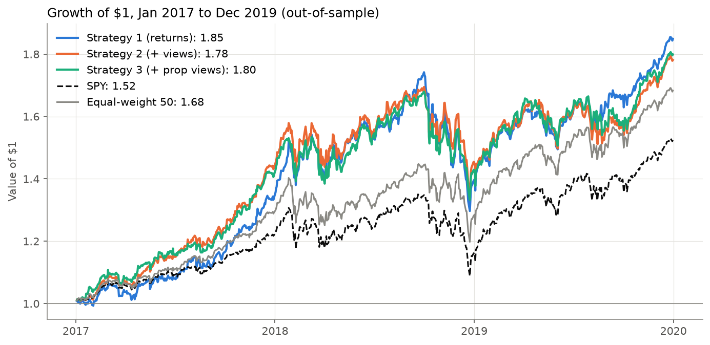
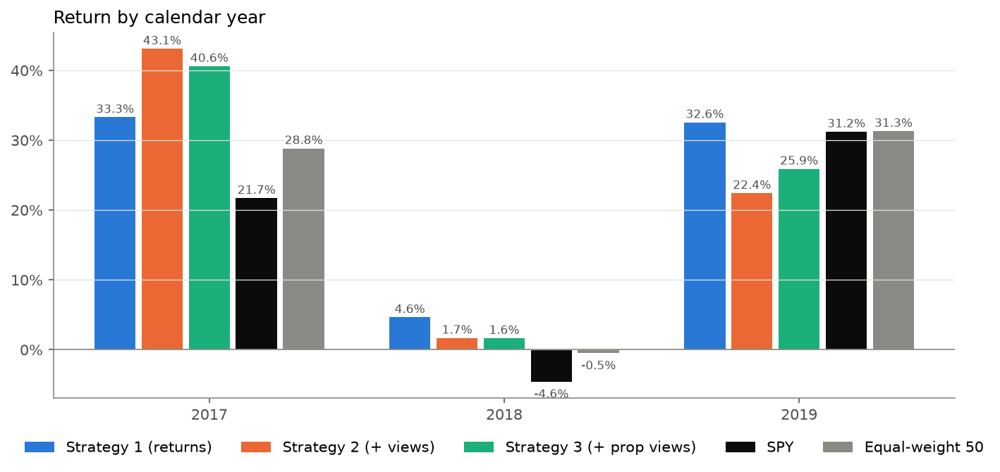
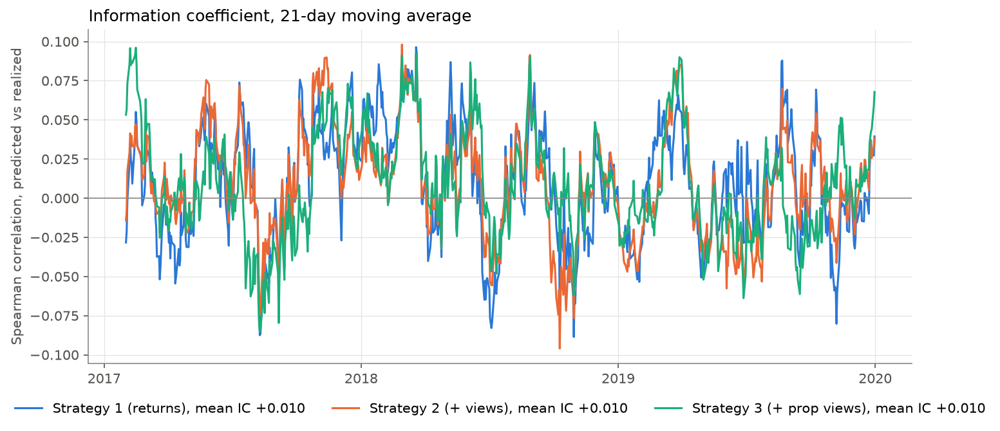
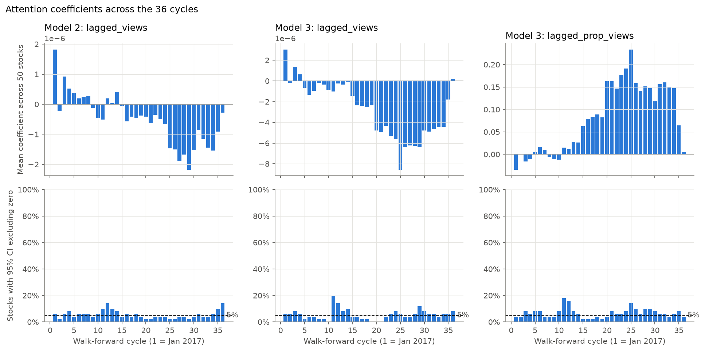
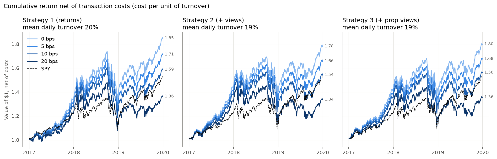
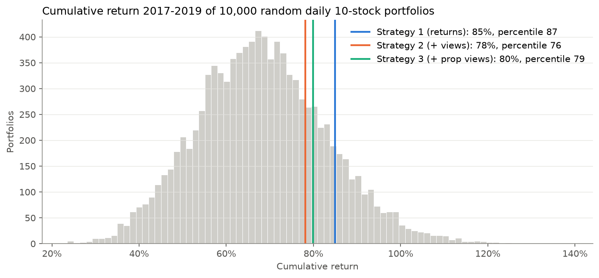

# Trading on Attention

Can Wikipedia pageviews predict daily stock returns? A walk-forward test on 2016–2019 data.

This project is based on the "Trading with AI" case from the AI for Business & Finance Certificate (Columbia Business School Executive Education × Wall Street Prep). It reimplements the case with independently downloaded data, keeps the model unchanged, and extends the test from one year (2017) to three (2017–2019) with a stricter evaluation.

## Question

Do lagged Wikipedia pageviews improve out-of-sample predictions of next-day returns for large U.S. stocks beyond lagged returns alone? And does a portfolio built on these predictions hold up against fair benchmarks, transaction costs and random stock selection?

## Data

- **Prices:** daily adjusted close for 50 large S&P 500 stocks and SPY, from `yfinance`.
- **Attention:** daily views of each company's English Wikipedia article and of the articles of four competitors, from the Wikimedia Pageviews API. The stock list and competitor groups come from the original case. As in the case, views are summed over the article and every page that redirects to it, so renamed articles (Amazon.com → Amazon (company), Facebook, Inc. → Meta Platforms) keep a continuous series.
- **Period:** January 2016 to December 2019. December 2015 is used only for the first lags, and data from 2020 onward is excluded to leave out COVID-19.

## Method

- **Features:** 7-day averages, lagged by one day, of the stock's return, its raw pageviews, and its share of its competitor group's pageviews (proportional views).
- **Models:** three nested OLS regressions per stock:
  - Model 1: return ~ lagged return
  - Model 2: Model 1 + lagged views
  - Model 3: Model 2 + lagged proportional views
- **Portfolio:** every day, hold the 10 stocks with the highest predicted return, equally weighted. The strategy is long-only and rebalanced daily.
- **Walk-forward:** train on 12 months, test on the next month, then roll forward one month. That gives 36 cycles and an out-of-sample test from January 2017 to December 2019.
- **Validation:** the first 12 cycles reproduce the original case's 2017 result. SPY returns 1.217 in both. Strategies 1, 2 and 3 return 1.33, 1.43 and 1.41 here, against roughly 1.33, 1.43 and 1.38 in the original.

The full model description and analysis plan are in the reports (see [Reports](#reports)).

## Results



| Jan 2017 – Dec 2019 | Cumulative | Annualized | Volatility | Sharpe | Max drawdown | Hit rate |
|---|---|---|---|---|---|---|
| Strategy 1 (returns) | 84.9% | 22.8% | 16.5% | 1.33 | -25.5% | 57.8% |
| Strategy 2 (+ views) | 78.1% | 21.3% | 15.8% | 1.30 | -20.2% | 56.4% |
| Strategy 3 (+ prop views) | 79.9% | 21.7% | 15.5% | 1.34 | -20.7% | 55.8% |
| SPY | 52.4% | 15.1% | 12.8% | 1.16 | -19.3% | 56.5% |
| Equal-weight 50 | 68.3% | 19.0% | 13.0% | 1.41 | -17.3% | 59.2% |

The Sharpe ratio uses rf = 0 and 252 trading days. The hit rate is the share of days with a positive return.











## Conclusion

- **Pageviews add nothing over lagged returns.** Strategy 1, which uses no pageviews, has the highest return. The views strategies win in 2017 (the year the original case tested) but trail Strategy 1 in 2018 and 2019. The mean information coefficient is about 0.01 for all three strategies, and none is statistically significant.
- **The attention coefficients are unstable and rarely significant.** Their 95% confidence interval excludes zero for only 5–7% of stocks per cycle, which is about what chance alone would give. The average coefficient on lagged views even changes sign during the test.
- **Most of the gain over SPY comes from the stock list, not the signal.** An equal-weight portfolio of the same 50 stocks beats SPY and has a higher Sharpe ratio than any strategy. Against 10,000 random daily 10-stock portfolios from the same list, the strategies rank at the 76th to 87th percentile, which is above average but within the range chance can produce.
- **Costs remove the edge.** The strategies replace about 20% of the portfolio every day. At 10 bps per unit of turnover their lead over SPY almost disappears, and at 20 bps all three end below both SPY and the equal-weight portfolio.

## How to run

```bash
pip install -r requirements.txt
```

Then run the notebooks in order:

1. `01_data.ipynb` downloads prices and pageviews into `data/`. This takes about 20 minutes because of the many redirect pages.
2. `02_model.ipynb` runs the 36-cycle walk-forward and the top-10 portfolio and saves the strategy returns, predictions and coefficients to `data/`.
3. `03_analysis.ipynb` produces the performance table and the analyses and saves the charts to `figures/`.

## Reports

- [Trading on Attention, report (English)](docs/Trading_on_Attention_report.pdf)
- [Trading on Attention, relatório (Português)](docs/Trading_on_Attention_relatorio_PT.pdf)
